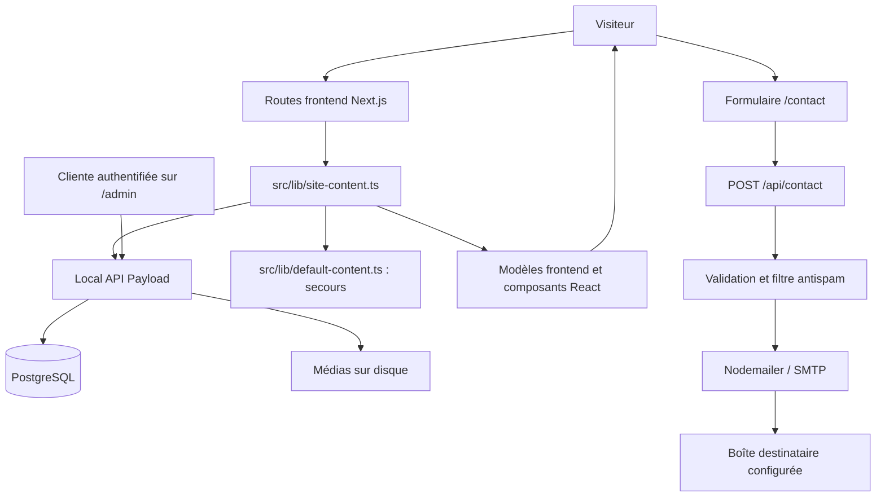

# Analyse de référence — Instant Present

> État analysé le 7 octobre 2026, depuis le dépôt `/home/ugo/projets/instant-present`, commit `e201a24` (`maj`). Ce document décrit le code présent et ses implications, pas un audit de l’infrastructure réellement déployée. À relire et actualiser après les changements importants.

## Mise à jour du 22 novembre 2026 : prévisualisation GitHub Pages

Une prévisualisation statique indépendante a été ajoutée. `npm run build:preview` prépare une copie du frontend dans `.cache/pages-preview`, utilise les contenus du code sans Payload, puis génère un export de 27 pages métier. `npm run check:preview` contrôle les routes, liens, assets et styles. Le workflow `.github/workflows/deploy-pages.yml` construit et publie sur push `main` ou déclenchement manuel ; le préfixe du dépôt est lu depuis `configure-pages`. Le formulaire est signalé comme désactivé et ne transmet aucune requête en mode preview. Les pages CMS génériques ne sont pas exportées. Le projet Next/Payload normal conserve sa configuration de serveur.

L’ancien workflow VM est désormais automatique seulement avec `ENABLE_VM_DEPLOY=true`, tout en restant déclenchable manuellement. Les descriptions historiques du déploiement automatique sur `main` dans le reste de ce document doivent être lues avec cette mise à jour. Procédure : [docs/github-pages-preview.md](docs/github-pages-preview.md).

## 1. Objet et périmètre

Site vitrine français pour l’activité de bien-être de Krystel Valquenart à Aubers : massages, rituels spécifiques, Head Spa, maternité et parentalité, nutrition et coaching, soin signature « Rituel Esprit ». La conversion recherchée est une demande de contact ou de rendez-vous auprès de la praticienne.

La cliente dispose de Payload CMS pour modifier les textes, prestations, visuels, navigation et coordonnées. Le site et le CMS sont intégrés à une seule application Next.js. La réservation n’est pas automatisée : aucun agenda, créneau, paiement en ligne, panier ou commande de carte cadeau n’est implémenté. Les cartes cadeaux sont présentées avec une invitation à contacter la praticienne.

L’analyse couvre les sources applicatives, schémas CMS, normalisateurs, contenus de secours, composants, routes, API, scripts, configuration, tests, déploiement et ressources versionnées. Les fichiers d’environnement privés ne sont pas reproduits. Aucune écriture en base, migration, synchronisation de contenu ou opération distante n’a été exécutée. Les contenus réellement enregistrés dans PostgreSQL, l’état SMTP, les comptes administrateurs et la configuration de production restent à vérifier séparément.

## 2. Vue d’ensemble du fonctionnement

Le parcours de rendu courant :

1. La page serveur charge les réglages et son contenu avec `Promise.all`.
2. `getPayloadClient()` initialise ou récupère Payload avec `src/payload.config.ts`.
3. La Local API lit un global ou une collection.
4. Les normalisateurs convertissent les documents Payload en objets frontend simples, résolvent les médias et appliquent les valeurs de secours.
5. Les composants affichent les sections ; les composants clients assurent le menu, les animations et le formulaire.

Les pages frontend déclarent `dynamic = 'force-dynamic'`. Elles sont donc rendues à la demande ; le code n’ajoute ni ISR, ni stratégie explicite de revalidation, ni cache métier partagé. Les modifications CMS sont relues lors d’une nouvelle requête. Il n’existe pas de webhook de publication ou de hook de revalidation personnalisé.

## 3. Stack et dépendances

Les versions suivantes sont celles déclarées dans `package.json`, avec leurs contraintes exactes ; le verrou effectif est `package-lock.json`.

| Outil | Version déclarée | Usage |
| --- | --- | --- |
| Next.js | `16.2.1` | App Router, routes serveur, metadata, fonts, images et hébergement du CMS |
| React / React DOM | `19.2.4` | Composants serveur et clients, hooks, `useEffectEvent` |
| Payload | `3.81.0` | Administration, authentification, collections, globals, Local API et API publiques |
| `@payloadcms/next`, `ui`, `richtext-lexical` | `3.81.0` | Intégration Next, interface admin, éditeur global Lexical |
| `@payloadcms/db-postgres` | `^3.81.0` | Adaptateur de base actif |
| `@payloadcms/db-sqlite` | `3.81.0` | Dépendance historique ; non utilisée par la configuration active |
| `pg` | `^8.21.0` | Pilote PostgreSQL |
| `graphql` | `^16.8.1` | Endpoint GraphQL de Payload |
| Tailwind CSS | `^4.2.2` | Classes utilitaires et thème déclaré dans le CSS |
| `@tailwindcss/postcss` / PostCSS | `^4.2.2` / `^8.5.8` | Compilation CSS |
| `lucide-react` | `^1.7.0` | Icônes d’interface et bénéfices |
| Nodemailer | `^8.0.7` | Envoi du formulaire via SMTP |
| Sharp | `0.34.2` | Traitement d’images fourni à Payload |
| dotenv | `16.4.7` | Chargement des variables dans les scripts/tests |
| cross-env | `^7.0.3` | Variables d’exécution dans les scripts npm |
| TypeScript | `5.7.3` | Typage strict et génération de types Payload |
| ESLint / eslint-config-next | `^9.16.0` / `16.2.1` | Analyse statique et règles React/Next |
| Prettier | `^3.4.2` | Formatage configuré |
| tsx | `4.21.0` | Exécution des scripts TypeScript |
| Vitest | `4.0.18` | Test d’intégration Local API |
| Playwright | `1.58.2` | Tests navigateur Chromium |
| Testing Library React | `16.3.0` | Installée, sans usage dans les tests présents |
| jsdom | `28.0.0` | Environnement Vitest |
| Plugin React Vite / vite-tsconfig-paths | `4.5.2` / `6.0.5` | Transformation React et alias dans Vitest |

Types de développement : `@types/node 22.19.9`, `@types/react 19.2.14`, `@types/react-dom 19.2.3`, `@types/nodemailer ^8.0.0`.

`package.json` annonce Node `^18.20.2 || >=20.9.0` et pnpm `^9 || ^10`. La CI utilise Node 22 ; Docker utilise Node 22.17.0 pour l’image de production et Node 20 pour Compose. La machine d’analyse utilise Node 26.3.1. Ne pas considérer la plage Node du package comme une validation de compatibilité de toutes les dépendances et du script `node:sqlite`.

La pratique actuelle de déploiement est npm (`npm ci`). `.npmrc` contient `legacy-peer-deps=true`. `.yarnrc` conserve une option historique d’ignorance des engines. Il n’y a pas de plugin métier Payload actif : `plugins: []`.

## 4. Organisation du dépôt

| Emplacement | Fonction |
| --- | --- |
| `src/app/(frontend)` | Layout public, styles et routes vitrines |
| `src/app/(payload)` | Admin, REST, GraphQL, layout et import map générés |
| `src/app/api/contact/route.ts` | Endpoint du formulaire |
| `src/app/my-route/route.ts` | Route exemple résiduelle du starter |
| `src/collections` | Sept collections enregistrées |
| `src/globals` | Neuf documents singleton éditables |
| `src/components` | Sections, layouts de pages et interactions |
| `src/lib/site-content.ts` | Lecture CMS et normalisation |
| `src/lib/default-content.ts` | Catalogue de secours et valeurs par défaut des schémas |
| `src/lib/site-model.ts` | Six modèles frontend indépendants des documents CMS |
| `src/lib/payload.ts` | Accès à l’instance Payload |
| `src/lib/contact-form.ts`, `contact-mail.ts` | Validation commune et envoi SMTP |
| `src/fields/slug.ts` | Champ slug avec hook de normalisation |
| `src/payload.config.ts` | Configuration centrale |
| `src/payload-types.ts` | Types générés ; ne pas modifier à la main |
| `public` | Assets servis directement : photos, logos, cartes, polices et SVG |
| `photos` | Sources photographiques JPG/PNG/HEIC, hors parcours applicatif |
| `idea` | Anciennes maquettes JSX et notes de conception |
| `scripts` | Initialisation, synchronisation, réparations, migration et déploiement |
| `tests` | Tests d’intégration, e2e et helpers |
| `docs` | Anciens guides GitHub et hébergement |
| `ops/nginx` | Exemple de reverse proxy |
| `.github/workflows` | Déploiement automatique sur `main` |
| `AGENTS.md` | Règles de développement Payload à appliquer |

Pas de modules métier dans `src/access` ou `src/hooks` dans l’état actuel. Le seul hook applicatif explicite est celui du slug. Les anciens prototypes `idea/` ne sont pas importés par les routes et sont ignorés par ESLint.

## 5. Carte des routes publiques

| URL | Source de contenu | Composant principal |
| --- | --- | --- |
| `/` | `home-page` et `site-settings` | `HomePageContent` |
| `/soins-bien-etre` | `wellness-page` | `WellnessPageContent` |
| `/soins-bien-etre/[slug]` | `wellness-service-pages` | `WellnessServiceDetailPage` |
| `/rituels-specifiques` | `rituals-page` | `WellnessPageContent` |
| `/rituels-specifiques/[slug]` | `ritual-service-pages` | `WellnessServiceDetailPage` |
| `/rituel-head-spa` | `head-spa-page` | `WellnessPageContent` |
| `/rituel-head-spa/[slug]` | `head-spa-service-pages` | `WellnessServiceDetailPage` |
| `/maternite-parentalite` | `maternity-page` | `WellnessPageContent` |
| `/maternite-parentalite/[slug]` | `maternity-service-pages` | `WellnessServiceDetailPage` |
| `/nutrition-coaching` | `nutrition-page` | `WellnessServiceDetailPage` |
| `/rituel-esprit` | `signature-ritual-page` | `SignatureRitualPage` |
| `/contact` | `booking-page` | `BookingPageContent` |
| `/mentions-legales` | Texte en code + coordonnées CMS | `LegalPageContent` |
| `/politique-de-confidentialite` | Texte en code + coordonnées CMS | `LegalPageContent` |
| `/cgv` | Texte en code + coordonnées CMS | `LegalPageContent` |
| `/[slug]` | Collection `pages` | `MarketingPage` |

Les routes métier entourent le contenu avec `SiteHeader` et `SiteFooter`. Les routes dynamiques attendent `params: Promise<{ slug: string }>` et appellent `notFound()` si aucun document ni secours n’est disponible. Les routes explicites prennent la priorité sur `/[slug]` : une page CMS ayant le slug `contact` ne remplace pas `/contact` et une page `home` ne remplace pas `/`.

La route générique affiche encore un design de starter orienté développeur : boutons « Ouvrir le CMS », « Doc Payload », textes Next/Payload/Tailwind et étapes techniques. Elle n’utilise pas le header/footer métier. Ce n’est pas un constructeur de pages complet.

### Catalogue de secours

Seize fiches de prestations sous quatre familles :

- Bien-être : `massage-ayurvedique`, `massage-intuitif`, `massage-lomi-lomi`, `massage-du-dos`, `relaxation-du-visage`, `massage-cranien`, `massage-plantaire`.
- Rituels : `liberation-emotionnelle-doterra`, `maderotherapie`, `drainage-lymphatique`, `massage-cire-bougie`.
- Head Spa : `rituel-classique`, `rituel-expert`, `rituel-enfant`.
- Maternité : `massage-prenatal`, `massage-bebe`.

Nutrition est un global autonome ; le soin signature a aussi sa propre route et son propre global. Tous les textes, tarifs et durées du code se trouvent dans `default-content.ts` ; ils ne prouvent pas les valeurs actuellement enregistrées dans le CMS.

## 6. Configuration et modèle Payload

`buildConfig` configure : admin sur `users`, import map relative à `src`, interface uniquement française (`fr`), éditeur global Lexical, secret `PAYLOAD_SECRET`, génération dans `src/payload-types.ts`, PostgreSQL avec `DATABASE_URL`, `allowIDOnCreate: true`, Sharp et aucun plugin.

Il n’y a pas de configuration explicite de `serverURL`, CORS/CSRF personnalisés, stockage S3, mail adapter Payload, preview, live preview, publication planifiée ou SEO plugin. Les réglages SMTP du formulaire appartiennent à Nodemailer et ne configurent pas automatiquement les mails d’authentification Payload.

### Collections

| Collection | Particularités |
| --- | --- |
| `users` | `auth: true`, titre admin email, aucun champ métier/role ajouté |
| `media` | Lecture publique, `alt` obligatoire, `upload: true` |
| `pages` | Lecture publique, titre, slug, hero, contenu textarea, `versions.drafts: true` |
| `wellness-service-pages` | Fiches bien-être, lecture publique, slug obligatoire unique indexé |
| `ritual-service-pages` | Même forme pour les rituels spécifiques |
| `head-spa-service-pages` | Même forme pour Head Spa |
| `maternity-service-pages` | Même forme pour maternité |

Les quatre collections de prestations ont `timestamps: true`, colonnes admin `title`, `slug`, `updatedAt`, titre admin `title`. Schéma commun :

- `title`, `slug`.
- `hero` : titre, sous-titre, upload de fond et alt.
- `practicalInfo` : durée, prix, libellé et URL du CTA.
- `overview` : titre manuscrit, titre, paragraphes `{ text }`, upload et alt.
- `audience` : titre et items `{ text }`.
- `benefits` : titre manuscrit, titre, items avec titre/description/icône.
- `cta` : titre, texte, liens et libellés principal/secondaire.

Les icônes de détail sont `droplets`, `wind`, `leaf`. Les valeurs par défaut d’une nouvelle fiche viennent de la première prestation de sa famille. Le slug des prestations est un simple champ texte : il n’utilise pas `src/fields/slug.ts`. Il faut donc le renseigner proprement et éviter de créer plusieurs documents avec le même slug par défaut.

Pour `pages`, le hook `beforeValidate` génère le slug depuis `title` s’il est absent et normalise les caractères/accentuation/séparateurs. Le hero contient eyebrow, headline obligatoire, description, deux CTA et une image. `content` est un textarea rendu en paragraphes, sans rendu Lexical. L’éditeur Lexical est configuré globalement mais aucun champ `richText` métier n’est défini.

### Globals

| Global | Groupes éditables |
| --- | --- |
| `site-settings` | Noms, tagline, navigation/sous-menus, description footer, contact, réseaux, CTA réservation, liens légaux |
| `home-page` | hero, about, approach, services, signatureFeature, audience, testimonials, contactBanner |
| `wellness-page` | hero, intro, services, benefits, cta |
| `rituals-page` | Même organisation de page catalogue |
| `head-spa-page` | Même organisation |
| `maternity-page` | Même organisation |
| `nutrition-page` | title, slug, hero, practicalInfo, overview, audience, benefits, cta |
| `booking-page` | hero, intro, reservation, contactMethods, form, giftCard, importantInfo, access, faq |
| `signature-ritual-page` | hero, overview, practicalInfo, profile, treatment, benefits, closingCta |

Tous ces globals déclarent une lecture publique. Ils ne configurent pas de versions/drafts. Les tableaux de cartes catalogue sont édités dans les globals, séparément des fiches de collection. Ce ne sont pas des relations vers les prestations : titres, descriptions, tarifs, liens et images peuvent diverger entre catalogue, menu, formulaire et fiche détail.

## 7. Lecture et normalisation du contenu

`site-model.ts` définit `SiteSettingsData`, `HomePageData`, `WellnessPageData`, `WellnessServiceDetailPageData`, `BookingPageData`, `SignatureRitualPageData`. Ces formes simplifiées évitent de faire dépendre tous les composants de la structure des relations et tableaux Payload.

`site-content.ts` importe les types générés, lit Payload et applique des règles importantes :

- Une relation média est utilisable seulement si elle est peuplée sous forme d’objet avec `url`. Un ID seul conduit au secours.
- Les tableaux de paragraphes `{ text }` deviennent des chaînes ; plusieurs tableaux sont filtrés pour enlever les valeurs vides.
- Beaucoup de textes utilisent `valeur || secours`. Effacer un texte dans le CMS peut donc réafficher le texte du code. Un tableau vide reste en revanche truthy et peut supprimer une liste visuellement.
- Plusieurs URL `#` ou `#contact` sont corrigées vers les valeurs par défaut.
- Des liens sont forcés à partir des titres exacts des prestations, même si une autre URL est saisie dans le CMS.
- Des anciens sous-menus sont détectés par leur texte (« Rituel évasion », « Head Spa Japonais complet », « Massage post-natal », « Bilan nutritionnel », etc.) et remplacés par le menu courant.
- Des anciens textes/visuels de la zone d’accès sont corrigés, notamment les anciennes images Unsplash.
- Les images de cartes manquantes utilisent souvent le secours au même index. Réordonner les cartes sans définir leurs médias peut afficher la photo d’une autre prestation.
- Une fiche CMS à slug inconnu utilise la première fiche par défaut de sa famille pour les champs manquants, ce qui peut produire un mélange de contenus.

Lecteurs disponibles : `getSiteSettings`, `getHomePageData`, `getBookingPageData`, `getWellnessPageData`, `getSignatureRitualPageData`, `getRitualsPageData`, `getHeadSpaPageData`, `getMaternityPageData`, `getNutritionPageData`, quatre `get…ServicePageBySlug`, `getPageBySlug`.

Les fiches sont recherchées avec `depth: 1`, `limit: 1`, `pagination: false`, `where.slug.equals`. Les globals n’imposent pas explicitement leur profondeur. Tous les lecteurs attrapent les exceptions ; les globals reviennent au contenu de secours, les fiches à leur secours connu, les pages génériques à `null`. Il n’y a pas de journalisation de ces erreurs.

**Conséquences pratiques :** une base indisponible peut laisser un site visuellement fonctionnel avec des tarifs ou coordonnées anciens ; supprimer une fiche standard ne retire pas son URL publique ; une panne de base sur une page générique produit une 404 ; la cliente ne contrôle pas exclusivement ce qui est visible via le CMS.

## 8. Composants et expérience utilisateur

| Composant | Fonction et comportement |
| --- | --- |
| `SiteHeader` | Client ; logo statique, navigation CMS, état actif par pathname, sous-menus desktop au survol, menu mobile en dessous de `xl`, verrouillage du scroll du body |
| `SiteFooter` | Serveur ; logo, description, quatre premiers liens du menu, coordonnées, Facebook, CTA, liens légaux et année courante |
| `HomePageContent` | Serveur ; slideshow, présentation, approche, cartes de services, mise en avant signature, public, témoignages en grille, bandeau final |
| `HeroSlideshow` | Client ; dédoublonnage des sources, rotation 5 s, fondu 1,6 s, arrêt de rotation si reduced-motion au montage |
| `WellnessPageContent` | Serveur ; catalogue réutilisé dans quatre familles, cartes avec ancre générée du titre, durée/prix, bénéfices et CTA |
| `WellnessServiceDetailPage` | Serveur ; template commun des seize fiches et nutrition, présentation/public/bénéfices/informations pratiques/CTA |
| `SignatureRitualPage` | Serveur ; template spécifique au soin signature |
| `BookingPageContent` | Client ; contact, formulaire, notifications, FAQ accordéon, cartes cadeaux et carte OpenStreetMap |
| `LegalPageContent` | Serveur ; intro, faits rapides et sections, textes passés par les routes |
| `MarketingPage` | Serveur ; page générique de starter avec contenu CMS et informations techniques |
| `FadeInSection` | Client ; IntersectionObserver, seuil 0,15 et marge basse -10 %, apparition une fois, délais paramétrables |
| `BackgroundIllustrations` | Conteneur décoratif vide ; les vrais SVG décoratifs sont placés directement dans les autres composants |
| `TestimonialsCarousel` | Client ; rotation, flèches, pagination et gestes tactiles ; présent mais non importé par les pages actuelles |

Le slideshow d’accueil reçoit une image CMS et trois images statiques du cabinet/massages : toutes ses diapositives ne sont pas administrables. Les témoignages réellement affichés sont des cartes en grille, sans intégration Google Reviews. Instagram existe dans le modèle CMS mais n’est pas affiché dans le footer.

La carte est une iframe OpenStreetMap avec coordonnées codées en dur autour de `50.59327431197072, 2.8226227860279547`. Modifier l’adresse dans Payload change les textes, pas la position de la carte. Le champ `mapImageUrl` est conservé dans le schéma/normalisateur mais n’est plus consommé par le composant. `encodedContactAddress` est calculé et inutilisé.

## 9. Design, polices et assets

`styles.css` importe Tailwind v4 et déclare le thème via `@theme` : rose `#cc8787`, forêt `#15574d`, crème `#faf1e8`, blush `#f1ddd7`, sauge `#48615c`. Style majoritairement utilitaire dans les JSX : sections larges, motifs SVG translucides, arrondis, portraits, cartes, typographie manuscrite et boutons de contact.

Polices : Montserrat pour le texte et Playfair Display pour les sous-titres via `next/font/google` ; Wishper Script depuis `public/fonts/wishper-script.woff` via `next/font/local`. Les polices Google nécessitent leur récupération au build ; Next assure ensuite leur intégration. Le site est en langue `fr`, thème clair, scroll fluide. Le fichier SCSS personnalisé admin est vide.

Assets publics : 18 JPG dans `site-images`, quatre PNG dans `branding` (logos et deux faces de carte cadeau), quatre SVG dans `illustrations`, une police WOFF. Environ 30 Mo dans `public`, 31 Mo dans les photos sources et 116 Ko dans `idea` au moment de l’analyse.

La plupart des photos métier utilisent `` avec désactivation locale de `@next/next/no-img-element`. Elles ne profitent pas de l’optimisation Next Image. Les logos utilisent `next/image` avec `unoptimized`. La page générique utilise Next Image pour son média.

`next.config.ts` autorise l’optimisation des images locales `/branding/**` et `/api/media/file/**`. `/site-images/**` n’est pas dans cette liste, ce qui est cohérent avec l’usage actuel de `` mais à adapter en cas de conversion. Aucun domaine distant d’image n’est configuré. L’intégration `withPayload` est active, avec `devBundleServerPackages: false`, alias d’extensions Webpack et racine Turbopack explicite.

Payload stocke les uploads localement avec `upload: true`. Pas de tailles d’image personnalisées, restriction MIME explicite, stockage objet externe ou pipeline HEIC métier. En production, le script relie le dossier `media` vers un emplacement persistant.

## 10. Formulaire de contact et SMTP

Le formulaire de `/contact` envoie du JSON à `POST /api/contact`. Le composant conserve les valeurs, erreurs, état d’envoi, notification et accordéon ouvert. Validation au blur, correction des erreurs au changement, validation globale avant soumission, bouton désactivé pendant l’envoi, reset après succès. Les notifications disparaissent après 5 s et utilisent une zone `aria-live`.

Les fonctions de `contact-form.ts` sont partagées entre frontend et serveur :

| Champ | Validation |
| --- | --- |
| Nom | Obligatoire, 2 à 120 caractères après trim |
| Téléphone | Obligatoire ; numéro français avec `0`, `+33` ou `0033`, ponctuation normalisée |
| Email | Obligatoire ; expression régulière de format simple |
| Prestation | Obligatoire, maximum 120 caractères ; aucune vérification d’appartenance aux options CMS |
| Message | Obligatoire, 10 à 3 000 caractères après trim |

`website` est un honeypot ; `formStartedAt` est un timestamp client. Un honeypot rempli, timestamp invalide, envoi en moins de 1,5 s ou formulaire âgé de plus de 12 h donne un faux succès `{ ok: true }` sans mail. Un timestamp absent est remplacé par l’heure actuelle, ce qui déclenche le filtre « trop rapide ». Ces marqueurs sont contrôlés par le client et peuvent être fabriqués.

L’endpoint force le runtime Node et le rendu dynamique. Il convertit les valeurs reçues en chaînes attendues, assainit le téléphone, applique l’antispam puis la validation. Réponses : 200 en cas de succès ou antispam, 400 avec `fieldErrors` si validation invalide, 500 et message générique sur exception. JSON malformé et panne SMTP passent tous deux dans le catch 500. Les erreurs serveur sont journalisées.

Nodemailer crée puis réutilise un transporter. Host et port obligatoires ; `SMTP_SECURE=true` ou port 465 active TLS direct. Identifiant et mot de passe doivent être soit tous deux présents, soit tous deux absents. Destinataire et expéditeur viennent de l’environnement, `replyTo` de l’email utilisateur. Le mail possède une version texte et HTML ; les données interpolées sont échappées et la date formatée en français/Europe-Paris.

Le nom de site dans le mail est fixé à `Instant Present` dans l’endpoint, indépendamment du global `site-settings`. Il n’y a pas de stockage des demandes dans Payload, de mail de confirmation au visiteur, de queue, de retry applicatif ou de suivi de livraison. Un succès SMTP ne prouve pas l’arrivée en boîte de réception.

## 11. Variables d’environnement

| Variable | Usage |
| --- | --- |
| `DATABASE_URL` | URL PostgreSQL active ; aussi lue par l’ancien script de réparation SQLite qui exige une URL `file:` |
| `PAYLOAD_SECRET` | Secret d’authentification Payload ; aucun secret de secours réel, seulement chaîne vide |
| `CONTACT_FORM_TO_EMAIL` | Destinataire réel des demandes |
| `CONTACT_FORM_FROM_EMAIL` | Expéditeur SMTP |
| `SMTP_HOST`, `SMTP_PORT` | Serveur et port |
| `SMTP_SECURE` | TLS direct |
| `SMTP_USER`, `SMTP_PASS` | Authentification SMTP optionnelle par paire |
| `SQLITE_DATABASE_URL` | Source de l’assistant de migration historique |
| `POSTGRES_DATABASE_URL` | Destination de migration prioritaire sur `DATABASE_URL` |
| `NODE_ENV`, `PORT`, `NODE_OPTIONS` | Runtime, processus PM2 et commandes |
| `CI` | Configuration des tests Playwright |

Les secrets GitHub Actions sont `DEPLOY_HOST`, `DEPLOY_PORT`, `DEPLOY_USER`, `DEPLOY_SSH_PRIVATE_KEY`. `.env.example` est le modèle public. Le contact affiché dans le CMS ne détermine pas le destinataire SMTP : ce sont deux réglages distincts.

## 12. Sécurité et droits d’accès

Les collections de contenu/médias et les globals définissent explicitement `read: () => true`. Les opérations d’écriture et la collection Users n’ont pas de règles métier explicites et s’appuient sur les comportements par défaut de Payload. Aucun RBAC, rôle admin/editor, protection de champ ou contrôle « propriétaire » n’est implémenté. Les utilisateurs authentifiés ne sont pas différenciés par métier.

Les lectures frontend et les scripts utilisent la Local API sans utilisateur ; son contournement d’accès par défaut est donc actif. C’est cohérent avec des lectures de contenus publics et des scripts administratifs mais ce comportement devient déterminant si des restrictions sont ajoutées. Toute future opération avec `user` doit inclure `overrideAccess: false` conformément à `AGENTS.md`.

`pages` active les drafts mais conserve une lecture publique sans contrainte `_status` explicite ; le lecteur ne définit pas non plus de filtre `_status` ni `overrideAccess: false`. Il faut vérifier et définir le comportement de publication souhaité avant de considérer les brouillons comme privés, y compris sur REST/GraphQL et dans les lectures locales. Cette analyse ne démontre pas une fuite effective d’un brouillon enregistré.

Il n’y a pas de hooks de cascade ou d’écriture imbriquée actuels. Pour les futurs hooks, transmettre `req` à chaque opération imbriquée et utiliser un drapeau de contexte contre les boucles.

Le formulaire échappe les données dans le mail et valide côté serveur. Il n’a pas de rate limit, CAPTCHA, limite explicite du corps de requête ou contrôle applicatif de l’origine. Le honeypot/timestamp limite les robots simples mais ne suffit pas à limiter un abus SMTP automatisé. Les URL CMS ne disposent pas d’un validateur de protocole métier.

Le `.gitignore` exclut dépendances, builds, `.env` principal et variantes locales listées, `test.env`, bases SQLite, médias, logs, caches et certificats PEM. Il n’ignore pas globalement toutes les variantes `.env.*` : revérifier l’ignorance avant d’ajouter un fichier d’environnement d’un nouveau nom.

## 13. API et administration

- `/admin/[[...segments]]` délègue à `RootPage` et `generatePageMetadata` Payload ; `not-found.tsx` délègue aussi au CMS.
- Layout admin : CSS Payload, SCSS local, `RootLayout` et server function `handleServerFunctions`.
- `admin/importMap.js` est généré et référence actuellement `CollectionCards` de `@payloadcms/next/rsc`, sans composant admin métier personnalisé.
- `/api/[...slug]` expose les handlers REST Payload : GET, POST, DELETE, PATCH, PUT, OPTIONS.
- `/api/graphql` expose POST et OPTIONS ; `/api/graphql-playground` est présent avec le handler Payload.
- `/api/contact` est la seule API métier personnalisée.
- `/my-route` initialise Payload puis retourne un message d’exemple ; ce n’est pas un healthcheck vérifiant le parcours métier et le SMTP.

Les API Payload et l’admin appartiennent à la même application et au même processus que le site. Une défaillance du serveur Next ou une mise à jour interrompant ce processus affecte les trois.

## 14. Scripts de données : utilité et effets

| Script | Ce qu’il fait réellement |
| --- | --- |
| `ensure-globals.ts` | `updateGlobal({ data: {} })` pour les neuf globals afin de matérialiser les documents/valeurs nécessaires ; écrit en base même si appelé « ensure » |
| `sync-default-content.ts` | Réécrit les neuf globals depuis le code et upsert les seize fiches par slug ; peut écraser les textes édités par la cliente |
| `update-site-contact-email.ts` | Met à jour uniquement l’email de contact du global avec la valeur fixée dans le script |
| `update-booking-gift-card-copy.ts` | Met à jour certains textes/libellés de cartes cadeaux dans `booking-page` |
| `repair-sqlite-globals.ts` | Utilise `node:sqlite`, ajoute d’anciennes colonnes manquantes, supprime des index non primaires et une table temporaire résiduelle ; refuse PostgreSQL |
| `migrate-sqlite-to-postgres.ts` | Génère `.cache/sqlite-to-postgres.load` pour pgloader ; ne migre pas la base lui-même |
| `push-local-content-to-prod.sh` | Ancien transfert de fichier SQLite par SSH/SCP, arrêt PM2, sauvegarde du fichier distant, remplacement, médias optionnels, relance |
| `deploy-remote.sh` | Installation/build/redémarrage de l’application en production |

`sync-default-content` convertit les listes de chaînes en objets CMS et ne charge pas les photos statiques comme documents Media. Les champs upload ne sont pas renseignés par ces mappings ; les images retombent sur les URL de secours si aucun média n’est déjà défini. Le script ne supprime pas les fiches supplémentaires créées dans le CMS.

L’assistant pgloader utilise `data only`, `create no tables`, `truncate`, `reset sequences`, `downcase identifiers`. Le schéma cible doit préexister. Il enlève le mot de passe de l’URL générée et demande son passage via `PGPASSWORD`. L’option `truncate` rend l’exécution finale remplaçante pour les données visées ; ce n’est pas une synchronisation incrémentale.

Le transfert SQLite est devenu incompatible avec le stockage applicatif actif PostgreSQL : remplacer un fichier `.db` ne modifie pas les contenus lus actuellement. Avec `SYNC_MEDIA=yes`, il effectue un `rsync --delete` des médias. Avec `RUN_REMOTE_SYNC_STEPS=yes`, il lance réparation et synchronisation de secours, dont les effets sont significatifs. Ne pas l’utiliser comme procédure PostgreSQL.

## 15. Build, CI et hébergement

Le workflow `Deploy Production` s’exécute sur push `main` et manuellement. Un groupe de concurrence annule le déploiement précédent encore en cours. Il checkout, prépare Node 22/cache npm, installe les dépendances dev, exécute `npx tsc --noEmit`, prépare SSH, crée les dossiers distants, synchronise les sources et exécute le script distant.

`rsync -az --delete` exclut Git, workflows, environnements, dépendances, build, rapports et fichiers de bases SQLite. `public`, `photos`, `idea` et les autres fichiers non exclus font partie de la synchronisation. Aucun test, lint, build CI préalable, validation HTTP après déploiement ou déploiement staging n’est inclus.

Le script distant utilise :

- code : `/var/www/instant-present/app` ;
- données partagées : `/var/www/instant-present/shared` ;
- `.env` et médias reliés par symlinks ;
- dossier `backups` créé mais aucune sauvegarde PostgreSQL exécutée.

Séquence : installation npm, arrêt PM2 (erreur tolérée), `ensure:globals`, génération import map, suppression `.next`, build, `pm2 startOrReload`, `pm2 save`. L’arrêt avant initialisation/build crée une indisponibilité. Avec `set -e`, un échec intermédiaire peut laisser l’application arrêtée. Le code est remplacé sur place ; aucun système de releases atomiques ou rollback n’est défini. L’annulation d’un workflow en cours n’offre pas de garantie de récupération du processus distant.

PM2 lance `npm start` en production, port 3000. PM2 est appelé via `npx` mais n’est pas une dépendance du package ; sa disponibilité fait partie du provisioning serveur. L’exemple Nginx est HTTP sur port 80, proxy vers `127.0.0.1:3000`, transfère host/IP/proto et upgrade WebSocket, limite la taille du corps à 20 Mo. La configuration TLS réelle n’est pas versionnée ; le guide décrit Certbot.

### Fichiers historiques à ne pas prendre pour configuration active

- Le guide Hostinger décrit encore SQLite, les symlinks et sauvegardes de fichier DB. Plusieurs affirmations ne correspondent plus au script actuel et au PostgreSQL actif.
- `docker-compose.yml` lance MongoDB et commente PostgreSQL : incompatible avec la configuration active sans adaptation.
- `Dockerfile` attend `.next/standalone`, mais `next.config.ts` ne configure pas `output: 'standalone'` : la recette Docker ne correspond pas au build actuel.
- Le README contient une grande partie du template Payload Blank/MongoDB/S3 et annonce des possibilités Media non configurées ici.
- Le guide de dépôt privé suppose un projet non versionné dans un ancien chemin ; ce contexte est obsolète.

## 16. Outils, commandes et règles de maintenance

| Commande | Usage |
| --- | --- |
| `npm ci` | Installer selon le lockfile |
| `npm run dev` | Next dev Webpack, sans server fast refresh |
| `npm run dev:turbo` | Next dev Turbopack, même option |
| `npm run devsafe` | Supprime `.next` puis démarre Webpack ; commande de nettoyage |
| `npm run build` | Build Next avec mémoire maximale 8 000 Mo |
| `npm start` | Serveur Next production |
| `npm run lint` | ESLint sur le dépôt, prototypes et types générés ignorés |
| `npx tsc --noEmit` | Contrôle TypeScript requis après modifications de code |
| `npm run generate:types` | Régénération après changement de schéma |
| `npm run generate:importmap` | Régénération après création/modification des composants selon les règles du dépôt |
| `npm run ensure:globals` | Initialisation avec écritures en base |
| `npm run sync:default-content` | Remplacement de contenu ; à exécuter seulement avec une intention explicite |
| `npm run migrate:sqlite-to-postgres` | Préparation du fichier pgloader |
| `npm run repair:sqlite-globals` | Réparation historique SQLite |
| `npm run test:int`, `test:e2e`, `test` | Tests de base existants |
| `npm run payload -- …` | CLI Payload |

TypeScript est strict, cible ES2022, moduleResolution bundler, alias `@/*` vers `src/*` et `@payload-config` vers la configuration. Les types Next générés sont inclus. Prettier : quotes simples, virgules finales, largeur 100, sans points-virgules.

Règles à garder pour les développements futurs : types Payload/générés, contrôle d’accès explicite avec `user`, transmission `req` dans les hooks, prévention des boucles, génération de types et import map quand applicable. Le document présent n’est pas une instruction d’exécuter les scripts de mutation.

## 17. Tests et contrôles effectués

Vitest : jsdom, plugin React, alias TS, chargement dotenv, un test `payload.find({ collection: 'users' })` qui vérifie seulement qu’une réponse existe. Ce n’est pas un test de droits REST ni du fonctionnement du site.

Playwright : Chromium desktop, trace au premier retry, deux retries en CI et un worker en CI. Serveur `pnpm dev`, réutilisation d’un serveur local, URL 3000. Les tests admin créent/suppriment le compte de test dans la base configurée ; il n’y a pas de séparation obligatoire de base de test.

Les assertions sont héritées du starter : l’accueil attend « Une base propre pour construire le site vitrine », l’admin cherche « Dashboard » et « Users » alors que la configuration a été francisée. Elles ne valident pas correctement les contenus actuels. Aucun test spécifique des seize prestations, des fallbacks, de la validation/antispam, du SMTP, des brouillons ou des droits n’est présent.

Contrôles exécutés pendant cette analyse :

- `npx tsc --noEmit --incremental false` : **réussi**, code de sortie 0.
- `npm run lint` : **échoué**, 9 erreurs et 2 warnings préexistants. Les 9 erreurs concernent les appels de fonctions issues de `useEffectEvent` depuis les événements du `TestimonialsCarousel`. Warning sur cette fonction dans les dépendances de l’effet ; warning sur `encodedContactAddress` inutilisé dans le formulaire.
- Tests d’intégration/e2e et build non exécutés. Les tests peuvent modifier la base et les anciens tests frontend attendent des textes obsolètes. Aucune validation navigateur/production n’est revendiquée.

Aucune source applicative n’a été modifiée pour cette demande ; l’objectif est une documentation de référence.

## 18. SEO, accessibilité et contenu juridique

Le layout public définit `lang="fr"`, titre `Instant Present`, mais une meta description encore générique (« Base de site vitrine en Next.js avec Payload CMS et Tailwind CSS. »). Les trois pages juridiques ont leurs propres metadata. Les pages de services/génériques ne génèrent pas de metadata spécifiques depuis le CMS.

Pas de fichier sitemap/robots dédié, balisage JSON-LD LocalBusiness, canonicals, Open Graph métier ou plugin SEO défini dans les sources. Les templates ont des titres et images avec alt, mais une stratégie SEO locale complète reste à construire.

Accessibilité : erreurs du formulaire, `aria-invalid`, région live et iframe nommée sont présents ; les décors sont généralement masqués aux lecteurs d’écran. Points précis à reprendre : bouton du menu mobile sans libellé accessible ni `aria-expanded`, sous-menus desktop dépendants du survol, lien Facebook iconique sans libellé, accordéon sans `aria-expanded`, absence de gestion explicite du focus/Escape du menu. Les sections FadeIn sont initialement en opacité 0 et dépendent de JavaScript/IntersectionObserver pour devenir visibles ; reduced-motion enlève les transitions mais ne rend pas immédiatement ces sections visibles.

Les textes juridiques sont codés dans les routes ; Payload gère seulement les coordonnées utilisées dans certains passages. Le README liste les informations à confirmer : identité légale, statut/SIREN/SIRET, TVA éventuelle, hébergeur, médiateur, paiement et cartes cadeaux. Ce relevé décrit l’état documentaire, sans certifier la conformité juridique. La carte OSM intègre un tiers ; la collecte effective comprend les demandes envoyées par email et l’administration Payload. Pas d’outil analytique, gestionnaire de consentement ou tracking marketing identifié dans le code applicatif.

## 19. Points de vigilance prioritaires pour la suite

| Priorité | Constat | Conséquence / piste |
| --- | --- | --- |
| Haute | Scripts/docs Docker/SQLite/MongoDB historiques | Se fonder sur `payload.config.ts` et remettre les procédures en cohérence avec PostgreSQL |
| Haute | Pas de sauvegarde PostgreSQL dans le déploiement | Définir backup/restauration réelle avant mutations de production |
| Haute | Arrêt PM2 avant build, pas de rollback | Prévoir récupération sur échec et procédure de déploiement plus résiliente |
| Haute | `sync-default-content` remplace les textes | Sauvegarder et utiliser uniquement pour réinitialisation volontaire |
| Haute | Erreurs CMS silencieuses et prestations de secours persistantes | Définir visibilité/publication et journalisation des erreurs |
| Haute | Drafts avec lecture publique et Local API privilégiée | Formaliser les droits de publication et tester les parcours |
| Moyenne | Contenus dupliqués entre fiches/catalogues/menu/formulaire | Relations ou source unique pour limiter les divergences |
| Moyenne | Pas de limitation de fréquence sur le formulaire | Limiter l’abus de l’envoi SMTP selon les besoins de production |
| Moyenne | Lint cassé et tests de starter | Corriger les hooks du composant inutilisé, actualiser les tests et intégrer les checks adaptés |
| Moyenne | Metadata génériques et pages CMS de starter | Finaliser SEO et parcours réellement destinés à la cliente |
| Moyenne | Photos lourdes principalement non optimisées | Mesurer les pages puis améliorer formats, chargement et tailles |
| Moyenne | Position de carte statique | Rendre coordonnées configurables ou documenter le changement manuel |
| Moyenne | Défauts de navigation clavier/menus animés | Compléter les attributs et interactions accessibles |
| Faible | Champs/composants conservés mais inutilisés | Réduire les options CMS trompeuses après décision produit |

Ces points sont relevés pour les tâches futures ; ils ne constituent pas des modifications réalisées pendant l’analyse.

## 20. Guide de reprise rapide pour une prochaine intervention

- **Texte ou image d’une page existante** : global/collection → normalisateur → modèle frontend → composant ; vérifier si un fallback ou une règle de titre remplace la valeur CMS.
- **Nouvelle prestation** : collection de famille et slug, carte du global catalogue, navigation, options du formulaire ; un document de collection seul ne l’ajoute pas automatiquement aux listes.
- **Prix/durée** : contrôler fiche, carte catalogue, accueil et soin signature si plusieurs affichages existent.
- **Suppression d’une prestation standard** : retirer le document ne suffit pas ; traiter aussi le fallback, les liens et cartes.
- **Modification des coordonnées** : `site-settings`, position OSM en code, variables destinataire/expéditeur SMTP indépendantes.
- **Modification du formulaire** : `contact-form.ts` pour la règle commune, composant client, route serveur, mail et schéma `BookingPage` si libellés/options concernés.
- **Changement des droits** : définir les rôles au besoin dans Users, access des schémas, lectures Local API et statut de publication ; générer les types.
- **Problème en production** : configuration PostgreSQL réelle, logs PM2, disponibilité des médias persistants, erreurs SMTP, état `.next` après build ; le fallback peut masquer une panne de contenu.
- **Déploiement** : lire le workflow et `deploy-remote.sh` réels avant les anciens guides. Ne pas utiliser le transfert SQLite pour déplacer des données PostgreSQL.

Les sources applicatives et la configuration sont l’autorité technique. Le contenu CMS en base est l’autorité éditoriale attendue, mais les fallbacks et règles de compatibilité limitent actuellement ce principe.

## 21. Inventaire détaillé des champs CMS

Inventaire extrait des configurations TypeScript ; les champs système Payload (IDs, timestamps, auth, versions, etc.) sont décrits par les types générés et ne sont pas répétés ici. Les valeurs par défaut proviennent majoritairement de `default-content.ts`.

### src/collections/HeadSpaServicePages.ts

- `title` : text (required).
- `slug` : text (required, unique, index).
- `hero` : group.
- `hero.title` : text.
- `hero.subtitle` : textarea.
- `hero.backgroundImage` : upload (relation → media).
- `hero.backgroundImageAlt` : text.
- `practicalInfo` : group.
- `practicalInfo.duration` : text.
- `practicalInfo.price` : text.
- `practicalInfo.ctaLabel` : text.
- `practicalInfo.ctaHref` : text.
- `overview` : group.
- `overview.scriptTitle` : text.
- `overview.title` : text.
- `overview.paragraphs` : array.
- `overview.paragraphs[].text` : textarea (required).
- `overview.image` : upload (relation → media).
- `overview.imageAlt` : text.
- `audience` : group.
- `audience.title` : text.
- `audience.items` : array.
- `audience.items[].text` : textarea (required).
- `benefits` : group.
- `benefits.scriptTitle` : text.
- `benefits.title` : text.
- `benefits.items` : array.
- `benefits.items[].title` : text (required).
- `benefits.items[].description` : textarea (required).
- `benefits.items[].icon` : select (required).
- `cta` : group.
- `cta.title` : text.
- `cta.text` : textarea.
- `cta.primaryLabel` : text.
- `cta.primaryHref` : text.
- `cta.secondaryLabel` : text.
- `cta.secondaryHref` : text.

### src/collections/MaternityServicePages.ts

- `title` : text (required).
- `slug` : text (required, unique, index).
- `hero` : group.
- `hero.title` : text.
- `hero.subtitle` : textarea.
- `hero.backgroundImage` : upload (relation → media).
- `hero.backgroundImageAlt` : text.
- `practicalInfo` : group.
- `practicalInfo.duration` : text.
- `practicalInfo.price` : text.
- `practicalInfo.ctaLabel` : text.
- `practicalInfo.ctaHref` : text.
- `overview` : group.
- `overview.scriptTitle` : text.
- `overview.title` : text.
- `overview.paragraphs` : array.
- `overview.paragraphs[].text` : textarea (required).
- `overview.image` : upload (relation → media).
- `overview.imageAlt` : text.
- `audience` : group.
- `audience.title` : text.
- `audience.items` : array.
- `audience.items[].text` : textarea (required).
- `benefits` : group.
- `benefits.scriptTitle` : text.
- `benefits.title` : text.
- `benefits.items` : array.
- `benefits.items[].title` : text (required).
- `benefits.items[].description` : textarea (required).
- `benefits.items[].icon` : select (required).
- `cta` : group.
- `cta.title` : text.
- `cta.text` : textarea.
- `cta.primaryLabel` : text.
- `cta.primaryHref` : text.
- `cta.secondaryLabel` : text.
- `cta.secondaryHref` : text.

### src/collections/Media.ts

- `alt` : text (required).

### src/collections/Pages.ts

- `title` : text (required).
- `slugField()` : fabrique de champ.
- `hero` : group.
- `hero.eyebrow` : text.
- `hero.headline` : text (required).
- `hero.description` : textarea.
- `hero.primaryActionLabel` : text.
- `hero.primaryActionHref` : text.
- `hero.secondaryActionLabel` : text.
- `hero.secondaryActionHref` : text.
- `hero.image` : upload (relation → media).
- `content` : textarea.

### src/collections/RitualServicePages.ts

- `title` : text (required).
- `slug` : text (required, unique, index).
- `hero` : group.
- `hero.title` : text.
- `hero.subtitle` : textarea.
- `hero.backgroundImage` : upload (relation → media).
- `hero.backgroundImageAlt` : text.
- `practicalInfo` : group.
- `practicalInfo.duration` : text.
- `practicalInfo.price` : text.
- `practicalInfo.ctaLabel` : text.
- `practicalInfo.ctaHref` : text.
- `overview` : group.
- `overview.scriptTitle` : text.
- `overview.title` : text.
- `overview.paragraphs` : array.
- `overview.paragraphs[].text` : textarea (required).
- `overview.image` : upload (relation → media).
- `overview.imageAlt` : text.
- `audience` : group.
- `audience.title` : text.
- `audience.items` : array.
- `audience.items[].text` : textarea (required).
- `benefits` : group.
- `benefits.scriptTitle` : text.
- `benefits.title` : text.
- `benefits.items` : array.
- `benefits.items[].title` : text (required).
- `benefits.items[].description` : textarea (required).
- `benefits.items[].icon` : select (required).
- `cta` : group.
- `cta.title` : text.
- `cta.text` : textarea.
- `cta.primaryLabel` : text.
- `cta.primaryHref` : text.
- `cta.secondaryLabel` : text.
- `cta.secondaryHref` : text.

### src/collections/Users.ts

Aucun champ métier ajouté explicitement.

### src/collections/WellnessServicePages.ts

- `title` : text (required).
- `slug` : text (required, unique, index).
- `hero` : group.
- `hero.title` : text.
- `hero.subtitle` : textarea.
- `hero.backgroundImage` : upload (relation → media).
- `hero.backgroundImageAlt` : text.
- `practicalInfo` : group.
- `practicalInfo.duration` : text.
- `practicalInfo.price` : text.
- `practicalInfo.ctaLabel` : text.
- `practicalInfo.ctaHref` : text.
- `overview` : group.
- `overview.scriptTitle` : text.
- `overview.title` : text.
- `overview.paragraphs` : array.
- `overview.paragraphs[].text` : textarea (required).
- `overview.image` : upload (relation → media).
- `overview.imageAlt` : text.
- `audience` : group.
- `audience.title` : text.
- `audience.items` : array.
- `audience.items[].text` : textarea (required).
- `benefits` : group.
- `benefits.scriptTitle` : text.
- `benefits.title` : text.
- `benefits.items` : array.
- `benefits.items[].title` : text (required).
- `benefits.items[].description` : textarea (required).
- `benefits.items[].icon` : select (required).
- `cta` : group.
- `cta.title` : text.
- `cta.text` : textarea.
- `cta.primaryLabel` : text.
- `cta.primaryHref` : text.
- `cta.secondaryLabel` : text.
- `cta.secondaryHref` : text.

### src/globals/BookingPage.ts

- `hero` : group.
- `hero.title` : text.
- `hero.quote` : text.
- `hero.backgroundImage` : upload (relation → media).
- `hero.backgroundImageAlt` : text.
- `intro` : group.
- `intro.title` : textarea.
- `intro.paragraphs` : array.
- `intro.paragraphs[].text` : textarea (required).
- `reservation` : group.
- `reservation.scriptTitle` : text.
- `reservation.title` : text.
- `reservation.description` : textarea.
- `reservation.facebookLabel` : text.
- `reservation.facebookUrl` : text.
- `contactMethods` : group.
- `contactMethods.phoneTitle` : text.
- `contactMethods.emailTitle` : text.
- `contactMethods.facebookTitle` : text.
- `form` : group.
- `form.title` : text.
- `form.description` : textarea.
- `form.nameLabel` : text.
- `form.phoneLabel` : text.
- `form.emailLabel` : text.
- `form.serviceLabel` : text.
- `form.servicePlaceholder` : text.
- `form.serviceOptions` : array.
- `form.serviceOptions[].value` : text (required).
- `form.messageLabel` : text.
- `form.messagePlaceholder` : textarea.
- `form.submitLabel` : text.
- `giftCard` : group.
- `giftCard.scriptTitle` : text.
- `giftCard.title` : text.
- `giftCard.introParagraph` : textarea.
- `giftCard.detailsParagraph` : textarea.
- `giftCard.orderTitle` : text.
- `giftCard.phoneLabel` : text.
- `giftCard.emailLabel` : text.
- `giftCard.facebookLabel` : text.
- `giftCard.formLabel` : text.
- `giftCard.imageFrontAlt` : text.
- `giftCard.imageBackAlt` : text.
- `importantInfo` : group.
- `importantInfo.title` : text.
- `importantInfo.items` : array.
- `importantInfo.items[].text` : textarea (required).
- `access` : group.
- `access.scriptTitle` : text.
- `access.title` : text.
- `access.location` : text.
- `access.note` : textarea.
- `access.mapImageUrl` : text.
- `access.mapImageAlt` : text.
- `access.mapLabel` : text.
- `faq` : group.
- `faq.title` : text.
- `faq.introText` : textarea.
- `faq.items` : array.
- `faq.items[].title` : text (required).
- `faq.items[].description` : textarea (required).
- `faq.items[].icon` : select (required).
- `faq.acceptanceText` : text.

### src/globals/HeadSpaPage.ts

- `hero` : group.
- `hero.title` : text.
- `hero.subtitle` : textarea.
- `hero.backgroundImage` : upload (relation → media).
- `hero.backgroundImageAlt` : text.
- `intro` : group.
- `intro.title` : text.
- `intro.paragraphs` : array.
- `intro.paragraphs[].text` : textarea (required).
- `services` : group.
- `services.itemCtaLabel` : text.
- `services.items` : array.
- `services.items[].title` : text (required).
- `services.items[].description` : textarea (required).
- `services.items[].duration` : text (required).
- `services.items[].price` : text.
- `services.items[].href` : text (required).
- `services.items[].image` : upload (relation → media).
- `services.items[].imageAlt` : text (required).
- `benefits` : group.
- `benefits.title` : text.
- `benefits.items` : array.
- `benefits.items[].title` : text (required).
- `benefits.items[].description` : textarea (required).
- `benefits.items[].icon` : select (required).
- `cta` : group.
- `cta.title` : text.
- `cta.text` : textarea.
- `cta.buttonLabel` : text.
- `cta.buttonHref` : text.

### src/globals/HomePage.ts

- `hero` : group.
- `hero.scriptTitle` : text.
- `hero.title` : textarea.
- `hero.accentTitle` : text.
- `hero.subtitle` : textarea.
- `hero.ctaLabel` : text.
- `hero.ctaHref` : text.
- `hero.backgroundImage` : upload (relation → media).
- `hero.backgroundImageAlt` : text.
- `about` : group.
- `about.scriptTitle` : text.
- `about.title` : text.
- `about.paragraphs` : array.
- `about.paragraphs[].text` : textarea (required).
- `about.image` : upload (relation → media).
- `about.imageAlt` : text.
- `approach` : group.
- `approach.title` : text.
- `approach.introText` : textarea.
- `approach.highlightedQuote` : textarea.
- `services` : group.
- `services.scriptTitle` : text.
- `services.title` : text.
- `services.items` : array.
- `services.items[].title` : text (required).
- `services.items[].description` : textarea (required).
- `services.items[].href` : text (required).
- `services.items[].image` : upload (relation → media).
- `services.items[].imageAlt` : text (required).
- `services.itemCtaLabel` : text.
- `services.ctaLabel` : text.
- `services.ctaHref` : text.
- `signatureFeature` : group.
- `signatureFeature.scriptTitle` : text.
- `signatureFeature.title` : text.
- `signatureFeature.subtitle` : textarea.
- `signatureFeature.description` : textarea.
- `signatureFeature.duration` : text.
- `signatureFeature.price` : text.
- `signatureFeature.primaryCtaLabel` : text.
- `signatureFeature.primaryCtaHref` : text.
- `signatureFeature.secondaryCtaLabel` : text.
- `signatureFeature.secondaryCtaHref` : text.
- `signatureFeature.image` : upload (relation → media).
- `signatureFeature.imageAlt` : text.
- `audience` : group.
- `audience.title` : text.
- `audience.paragraphs` : array.
- `audience.paragraphs[].text` : textarea (required).
- `audience.highlightedText` : textarea.
- `audience.image` : upload (relation → media).
- `audience.imageAlt` : text.
- `testimonials` : group.
- `testimonials.scriptTitle` : text.
- `testimonials.title` : text.
- `testimonials.items` : array.
- `testimonials.items[].quote` : textarea (required).
- `testimonials.items[].author` : text (required).
- `contactBanner` : group.
- `contactBanner.text` : textarea.

### src/globals/MaternityPage.ts

- `hero` : group.
- `hero.title` : text.
- `hero.subtitle` : textarea.
- `hero.backgroundImage` : upload (relation → media).
- `hero.backgroundImageAlt` : text.
- `intro` : group.
- `intro.title` : text.
- `intro.paragraphs` : array.
- `intro.paragraphs[].text` : textarea (required).
- `services` : group.
- `services.itemCtaLabel` : text.
- `services.items` : array.
- `services.items[].title` : text (required).
- `services.items[].description` : textarea (required).
- `services.items[].duration` : text (required).
- `services.items[].price` : text.
- `services.items[].href` : text (required).
- `services.items[].image` : upload (relation → media).
- `services.items[].imageAlt` : text (required).
- `benefits` : group.
- `benefits.title` : text.
- `benefits.items` : array.
- `benefits.items[].title` : text (required).
- `benefits.items[].description` : textarea (required).
- `benefits.items[].icon` : select (required).
- `cta` : group.
- `cta.title` : text.
- `cta.text` : textarea.
- `cta.buttonLabel` : text.
- `cta.buttonHref` : text.

### src/globals/NutritionPage.ts

- `title` : text.
- `slug` : text.
- `hero` : group.
- `hero.title` : text.
- `hero.subtitle` : textarea.
- `hero.backgroundImage` : upload (relation → media).
- `hero.backgroundImageAlt` : text.
- `practicalInfo` : group.
- `practicalInfo.duration` : text.
- `practicalInfo.price` : text.
- `practicalInfo.ctaLabel` : text.
- `practicalInfo.ctaHref` : text.
- `overview` : group.
- `overview.scriptTitle` : text.
- `overview.title` : text.
- `overview.paragraphs` : array.
- `overview.paragraphs[].text` : textarea (required).
- `overview.image` : upload (relation → media).
- `overview.imageAlt` : text.
- `audience` : group.
- `audience.title` : text.
- `audience.items` : array.
- `audience.items[].text` : textarea (required).
- `benefits` : group.
- `benefits.scriptTitle` : text.
- `benefits.title` : text.
- `benefits.items` : array.
- `benefits.items[].title` : text (required).
- `benefits.items[].description` : textarea (required).
- `benefits.items[].icon` : select (required).
- `cta` : group.
- `cta.title` : text.
- `cta.text` : textarea.
- `cta.primaryLabel` : text.
- `cta.primaryHref` : text.
- `cta.secondaryLabel` : text.
- `cta.secondaryHref` : text.

### src/globals/RitualsPage.ts

- `hero` : group.
- `hero.title` : text.
- `hero.subtitle` : textarea.
- `hero.backgroundImage` : upload (relation → media).
- `hero.backgroundImageAlt` : text.
- `intro` : group.
- `intro.title` : text.
- `intro.paragraphs` : array.
- `intro.paragraphs[].text` : textarea (required).
- `services` : group.
- `services.itemCtaLabel` : text.
- `services.items` : array.
- `services.items[].title` : text (required).
- `services.items[].description` : textarea (required).
- `services.items[].duration` : text (required).
- `services.items[].price` : text.
- `services.items[].href` : text (required).
- `services.items[].image` : upload (relation → media).
- `services.items[].imageAlt` : text (required).
- `benefits` : group.
- `benefits.title` : text.
- `benefits.items` : array.
- `benefits.items[].title` : text (required).
- `benefits.items[].description` : textarea (required).
- `benefits.items[].icon` : select (required).
- `cta` : group.
- `cta.title` : text.
- `cta.text` : textarea.
- `cta.buttonLabel` : text.
- `cta.buttonHref` : text.

### src/globals/SignatureRitualPage.ts

- `hero` : group.
- `hero.scriptTitle` : text.
- `hero.title` : textarea.
- `hero.quote` : textarea.
- `hero.backgroundImage` : upload (relation → media).
- `hero.backgroundImageAlt` : text.
- `practicalInfo` : group.
- `practicalInfo.durationLabel` : text.
- `practicalInfo.duration` : text.
- `practicalInfo.priceLabel` : text.
- `practicalInfo.price` : text.
- `practicalInfo.ctaLabel` : text.
- `practicalInfo.ctaHref` : text.
- `overview` : group.
- `overview.scriptTitle` : text.
- `overview.title` : textarea.
- `overview.paragraphs` : array.
- `overview.paragraphs[].text` : textarea (required).
- `overview.image` : upload (relation → media).
- `overview.imageAlt` : text.
- `profile` : group.
- `profile.title` : text.
- `profile.items` : array.
- `profile.items[].text` : textarea (required).
- `treatment` : group.
- `treatment.title` : text.
- `treatment.paragraphs` : array.
- `treatment.paragraphs[].text` : textarea (required).
- `benefits` : group.
- `benefits.scriptTitle` : text.
- `benefits.title` : text.
- `benefits.items` : array.
- `benefits.items[].title` : text (required).
- `benefits.items[].description` : textarea (required).
- `benefits.items[].icon` : select (required).
- `closingCta` : group.
- `closingCta.title` : text.
- `closingCta.text` : textarea.
- `closingCta.primaryLabel` : text.
- `closingCta.primaryHref` : text.
- `closingCta.secondaryLabel` : text.
- `closingCta.secondaryHref` : text.

### src/globals/SiteSettings.ts

- `siteName` : text (required).
- `shortSiteName` : text (required).
- `tagline` : textarea.
- `navigation` : array.
- `navigation[].title` : text (required).
- `navigation[].href` : text (required).
- `navigation[].submenu` : array.
- `navigation[].submenu[].title` : text (required).
- `navigation[].submenu[].href` : text (required).
- `footerDescription` : textarea.
- `contact` : group.
- `contact.address` : textarea.
- `contact.phone` : text.
- `contact.email` : email.
- `socials` : group.
- `socials.instagramUrl` : text.
- `socials.facebookUrl` : text.
- `bookingCta` : group.
- `bookingCta.label` : text.
- `bookingCta.href` : text.
- `legalLinks` : array.
- `legalLinks[].label` : text (required).
- `legalLinks[].href` : text (required).

### src/globals/WellnessPage.ts

- `hero` : group.
- `hero.title` : text.
- `hero.subtitle` : textarea.
- `hero.backgroundImage` : upload (relation → media).
- `hero.backgroundImageAlt` : text.
- `intro` : group.
- `intro.title` : text.
- `intro.paragraphs` : array.
- `intro.paragraphs[].text` : textarea (required).
- `services` : group.
- `services.itemCtaLabel` : text.
- `services.items` : array.
- `services.items[].title` : text (required).
- `services.items[].description` : textarea (required).
- `services.items[].duration` : text (required).
- `services.items[].price` : text.
- `services.items[].href` : text (required).
- `services.items[].image` : upload (relation → media).
- `services.items[].imageAlt` : text (required).
- `benefits` : group.
- `benefits.title` : text.
- `benefits.items` : array.
- `benefits.items[].title` : text (required).
- `benefits.items[].description` : textarea (required).
- `benefits.items[].icon` : select (required).
- `cta` : group.
- `cta.title` : text.
- `cta.text` : textarea.
- `cta.buttonLabel` : text.
- `cta.buttonHref` : text.
